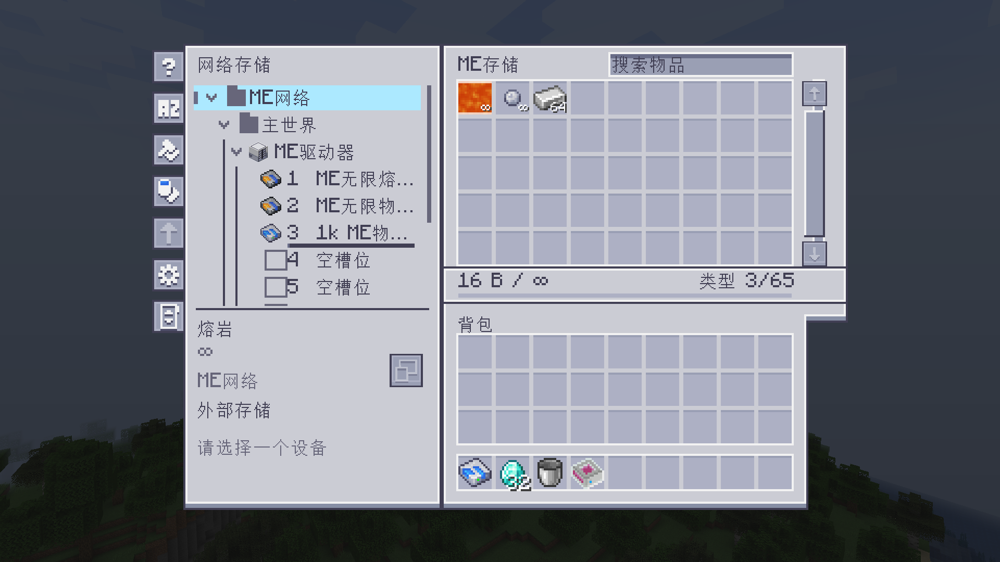

<div align="center">

# ME Storage Controller

**Explore your ME storage, one branch at a time.**

[](CHANGELOG.md)


[](LICENSE)
[](docs/ASSETS.md)

[简体中文](README.md) · [Documentation](docs/README.md) · [Changelog](CHANGELOG.md)

</div>

An **Applied Energistics 2 addon for Minecraft 1.20.1 Forge**. Browse your network as a tree, inspect folders, devices and individual cells, and transfer resources within the selected scope.



*Captured in 0.4.16. Version 0.4.17 retains this interface.*

## Features

- **Inspect capacity and contents.** See actual resource counts and automatically scaled capacity units, from KB through TB and beyond.
- **Organize shared folders.** Group devices and cell slots into named, nested folders. Grouping changes metadata only; it never moves blocks, items or cells.
- **Transfer in place.** Move items, fill or empty supported fluid and chemical containers, and manage complete cells through dedicated cell slots.
- **Keep the familiar AE feel.** Light and dark themes, search, sorting, personal tree-state memory and device highlighting, using Minecraft's existing GUI scale.

## Getting started

The development and validation baseline is **Java 17, Minecraft 1.20.1, Forge 47.4.0, AE2 15.4.10 and GuideME 20.1.7**. Use Forge builds of the dependencies.

1. Install the mod and its dependencies in `mods` on both client and server.
2. Connect an **ME Storage Controller** to a powered ME network with **one free channel**.
3. Right-click to open it. Hold **G** over the item or use the sidebar Guide button for the in-game guide, available in English and Simplified Chinese.

The block does not supply channels or replace AE2's ME Controller. Transfers follow native AE2 power, filtering and permission rules. Protocol 10 is incompatible with 0.4.15 and earlier; matching client/server versions are recommended.

No GitHub Release has been published yet. Build an installation JAR from source with **JDK 17**:

```powershell
.\gradlew.bat build
```

On Linux/macOS, use `./gradlew build`. Install the JAR without `-sources` from `build/libs/`.

## Optional addon support

| Addon | Support |
| --- | --- |
| ExtendedAE | Extended drives and custom infinity cells, including lava and matter balls |
| AE2 Omni Cells | Omni, Complex Omni and Quantum capacities, type limits and known unlimited bounds |
| Applied Mekanistics + Mekanism | Chemical contents and containers supported by registered AE2 strategies |
| AE2 storage buses | Connected containers, exposed capacity, filtering and access modes |

Only storage visible to the current network is included. Folder transfers stay within their members; unavailable or ambiguous overlapping storage may prevent an aggregate transfer. OmniCells quantities beyond AE2's public 64-bit counters cannot be represented exactly. See the [user guide](docs/USER_GUIDE.md) for details.

The [documentation](docs/README.md) is primarily in Chinese. It includes [development instructions](docs/DEVELOPMENT.md), [validation records](docs/VALIDATION.md) and the [changelog](CHANGELOG.md).

## License and credits

Original code, scripts and documentation use [MIT](LICENSE). Included AE2 artwork, derived models and visual adaptations use **CC BY-NC-SA 3.0**; see [asset provenance and attribution](docs/ASSETS.md) and the [bundled notice](src/main/resources/AE2-ASSET-NOTICE.txt).

Thanks to Applied Energistics 2 and its artists. This is an independent addon.
