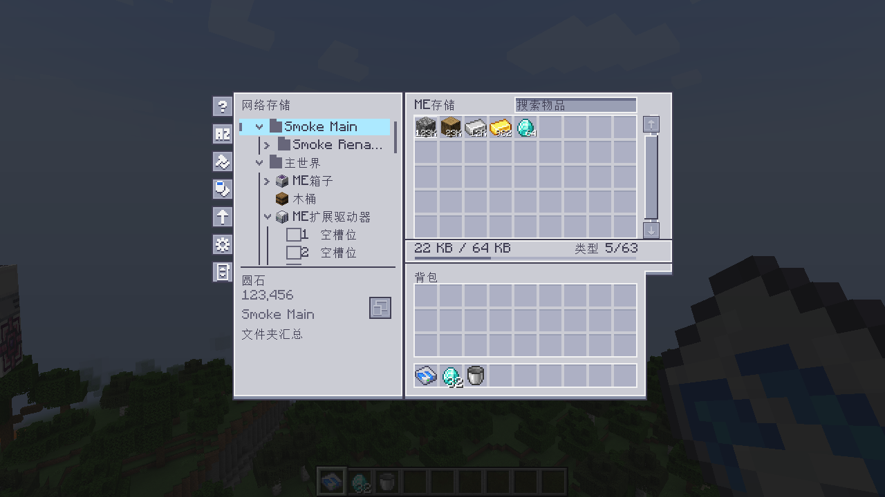
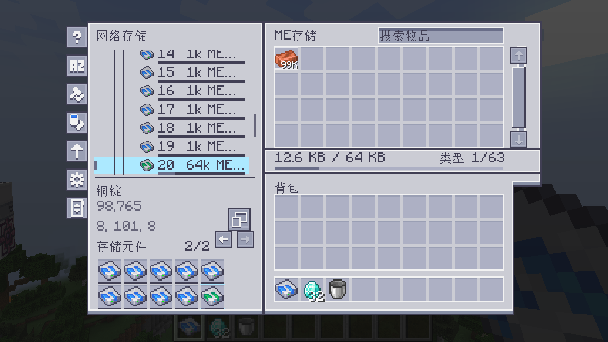
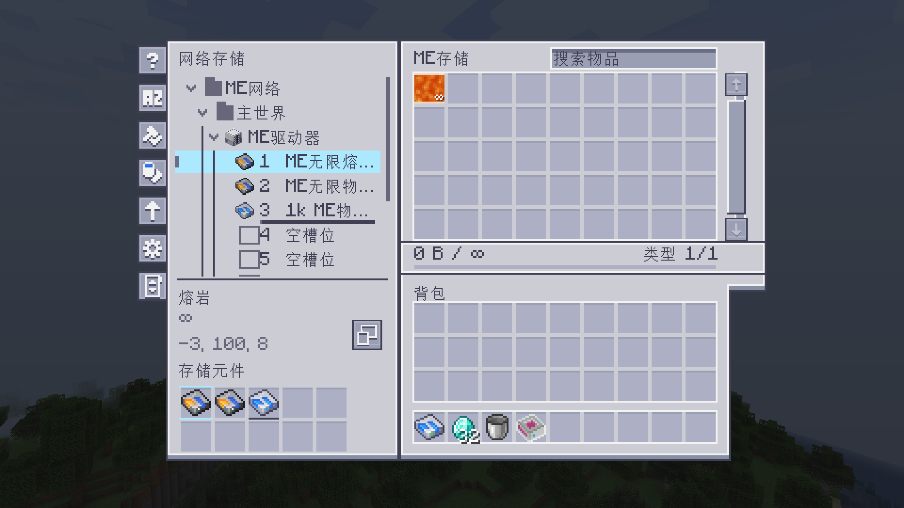

<div align="center">

# ME存储控制器

**把ME网络里的存储，整理成一棵看得清的树。**

[](CHANGELOG.md)


[](LICENSE)
[](docs/ASSETS.md)

[使用指南](docs/USER_GUIDE.md) · [更新记录](CHANGELOG.md) · [开发指南](docs/DEVELOPMENT.md) · [English](README.en.md)

</div>

ME存储控制器是适用于 **Minecraft 1.20.1 Forge** 的 Applied Energistics 2 附属模组。连接ME网络后，就能按网络、文件夹、设备和存储元件逐级查看容量与内容，并在选定范围内存入、取出资源。


*0.4.16实机截图；0.4.17沿用该界面。*

## 从总览到每一片元件

- **看清存储。** 文件树展示驱动器、外部容器和元件，容量自动换算为KB、MB、GB、TB，内容显示实际数量。
- **按自己的方式整理。** 多选后建立共享文件夹，支持嵌套、重命名和范围汇总。归组只改变分类，物品、方块和元件仍在原处。
- **直接存取。** 操作物品，或使用对应容器取放流体与化学品；也能在实际元件槽里管理整片存储元件。
- **保持熟悉的AE风格。** 深浅主题、搜索排序、折叠记忆与设备定位；沿用Minecraft的界面比例。

<details>
<summary>查看文件夹与元件操作</summary>

**文件夹汇总** · 选择文件夹后，只查看和操作其中的存储。



**元件详情** · 查看单个槽位，使用下方元件槽取放完整元件。



**自定义无限元件** · 正确显示无限熔岩、无限物质球等已识别元件的资源和∞标记。



</details>

## 开始使用

开发与验证使用以下环境：

| 依赖 | 版本 |
| --- | --- |
| Minecraft | 1.20.1 |
| Forge | 47.4.0 |
| Java | 17 |
| Applied Energistics 2 | 15.4.10 |
| GuideME（该AE2版本的依赖） | 20.1.7 |

1. 将本模组和依赖的Forge版本装入实例的 `mods` 文件夹。多人游戏中，客户端和服务器都需要安装。
2. 放置**ME存储控制器**，通过ME线缆连接已供电的网络，并留出**1个频道**。
3. 右键打开。物品上长按 **G**，或点击侧栏指南按钮，即可查看游戏内说明。

控制器不提供频道，也不替代AE2的ME控制器。存取遵循AE2原有的供电、过滤与权限规则。

目前尚未发布GitHub Release，安装包可从源码[构建](docs/DEVELOPMENT.md)。客户端与服务器建议使用同一版本；当前协议为10，与0.4.15及更早版本不兼容。

## 附属支持

| 附属 | 支持内容 |
| --- | --- |
| ExtendedAE | 扩展驱动器，以及无限熔岩、无限物质球等自定义无限元件 |
| AE2 Omni Cells | Omni、Complex Omni与Quantum元件的容量、类型和已知无限上限 |
| Applied Mekanistics + Mekanism | 化学品内容，以及AE2已注册策略支持的容器操作 |
| 存储总线 | 连接普通容器的内容与可读取容量，保留总线过滤及存取设置 |

这些附属均为可选。具体版本与边界见[使用指南](docs/USER_GUIDE.md)，已完成的检查见[验证记录](docs/VALIDATION.md)。

## 开发与文档

使用 **JDK 17**，在仓库根目录运行：

```powershell
.\gradlew.bat build
```

Linux或macOS使用 `./gradlew build`。安装包位于 `build/libs/`，选择不带 `-sources` 的JAR。

[文档目录](docs/README.md) · [开发与测试](docs/DEVELOPMENT.md) · [手动验收清单](docs/MANUAL_TEST_PLAN.md)

## 许可与致谢

原创代码、脚本和文档采用 [MIT](LICENSE)。收录的AE2美术、衍生模型及视觉改编采用 **CC BY-NC-SA 3.0**，详见[资源来源与署名](docs/ASSETS.md)。两者分开授权。

感谢Applied Energistics 2及其资源作者。本项目为独立附属模组。
